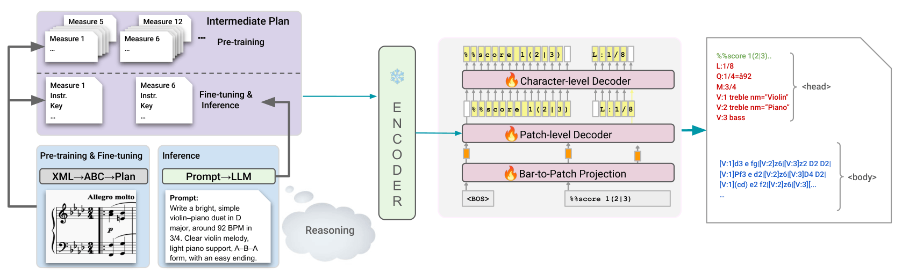

# Text2Music (Text2Score)

Text to music score generation.

[](https://keshavbhandari.github.io/portfolio/text2score)
[](https://huggingface.co/datasets/emotionwave-company/text2score)
[](#)

## System Overview
For a high-level view of the model architecture and pipeline, please see the system overview below:



---

## Installation

**1. Create and activate a new Conda environment**
```bash
conda create --name text2score python=3.10
conda activate text2score
```

**2. Install PyTorch with CUDA support**
```bash
conda install pytorch=2.3.0 pytorch-cuda=11.8 numpy -c pytorch -c nvidia
```

**3. Install the project and dependencies**
Ensure you are in the root directory (where `pyproject.toml` is located) and run:
```bash
pip install -e .
pip install optimum
```
*(Note: Most dependencies like `transformers`, `accelerate`, and `wandb` are handled automatically by the `pyproject.toml` file.)*

---

## Inference & Usage

All scripts should be executed from within the root `text2score` directory. 

### 1. Generating Plans from Prompts
Before running batch inference, you can generate an execution plan based on a JSON of prompts.
```bash
python text2music/inference/generate_plan.py \
  --api_key "XXXX" \
  --input_json text2music/artifacts/evaluation/prompts_with_ids.json \
  --output_json text2music/artifacts/evaluation/prompts_with_plan.json
```

### 2. Single Inference
To generate a score from a single text prompt:
```bash
python text2music/inference/inference.py \
  --user_prompt "A melancholic solo flute melody settling back into D minor, composed as a slow 6/8 barcarolle at 54 BPM." \
  --api_key "XXXX" \
  --remove_prior_outputs False
```
If you already have a pre-generated plan text file, use:
```bash
python text2music/inference/inference.py \
  --plan_path text2music/notebooks/partial_plan.txt \
  --remove_prior_outputs False
```

### 3. Batch Inference
Run inference across multiple prompts using `accelerate` (ensure your accelerate configs are set up properly):
```bash
accelerate launch --num_processes 1 text2music/inference/run_inference.py \
  --prompt_path_json text2music/artifacts/evaluation/prompts_with_plan.json \
  --output_folder ./outputs/
```

---

## Data Conversion (ABC to XML & MIDI)

Once you have generated ABC files, you can batch convert them into standard XML and MIDI formats.

**Create XML files:**
```bash
python text2music/data/batch_abci2xml.py --root_folder ./outputs/
```

**Create MIDI files:**
```bash
python text2music/data/utils/xml2mid.py --data_dir ./outputs/
```

---

## Evaluation

To evaluate the generated objective results against your metadata:
```bash
python text2music/scripts/evaluation.py \
  --root ./outputs/ \
  --metadata text2music/artifacts/evaluation/prompts_with_plan.json \
  --output_txt text2music/scripts/results_valid/text2score_objective_results.txt
```

---

## Training

Ensure your `accelerate` configs are initialized and that your train/validation `.jsonl` files contain the correct paths to your `.abci` and `.pkl` files.

**Run Pretraining:**
```bash
accelerate launch --num_processes 2 text2music/pretrain/train-gen.py
```

**Run Fine-tuning:**
```bash
accelerate launch --num_processes 2 text2music/finetune/train-gen.py
```